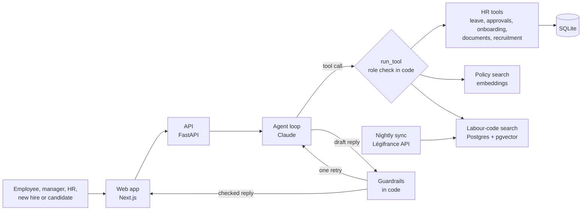

# Agent HRM

An AI HR assistant and a web HR system for small French companies (10–50 people) that have no HR team.

Employees, managers and HR use one web app with the assistant in a side panel. It answers in the person's language
(English or French), and anything it wants to change waits for a person to confirm it.

## What it does

- **Leave:** balances, booking and cancelling (casual, sick and French paid leave), public and floating holidays,
  and the yearly balance reset.
- **Approvals:** managers see what is pending and approve or reject it; HR and managers get one "Needs you" inbox.
- **Onboarding:** a checklist for each new hire with owners and due dates, reminders, a private welcome link, and an
  employment contract drafted from a template, checked against the law and approved by a person.
- **Documents:** read-only payslips, each person's own documents, and HR requests (tickets).
- **Recruitment:** a careers page, an assistant for candidates on their private tracking link, application summaries
  for HR, and interview scheduling. Candidate data is erased on the CNIL's retention periods. The assistant never
  ranks or picks candidates: a person decides.
- **Policy and labour-law answers:** answers from the company policy, the collective agreement (once HR uploads it)
  and the French Code du travail, with the article cited. Questions the policy doesn't answer are kept for HR,
  without names.

## How it works



- **The agent:** a plain loop on the Anthropic API, no framework. The model asks for a tool, code runs it, and the
  loop stops after 8 calls. The reasoning for this and every other choice is in [docs/decisions.md](docs/decisions.md).
- **One gateway for tools:** every tool call goes through one function, `run_tool`. It checks the person's role in code
  before anything runs, and "me" is always the signed-in person, never a name the model wrote.
- **Role-based tools:** five roles (employee, manager, HR, new hire, candidate). Each role only sees its own tools.
  A new hire can only read their onboarding; a candidate can only read their own application.
- **A person confirms every change:** to book leave, approve, cancel or open a ticket, the assistant doesn't act. The
  app shows a card, and only "Confirm" runs it, through the same `run_tool` checks.
- **Output guardrails:** code checks each reply before it is shown. A number of days, an amount or a count that no
  tool returned this turn, a law article that wasn't retrieved, a rules question answered without searching, or
  a reason the policy doesn't contain (a second model checks that one). A failing reply is sent back once; if it
  still fails, a safe reply replaces it.
- **Policy search (RAG):** the policy is cut at its headings and embedded with OpenAI `text-embedding-3-small`.
- **Labour-law search (RAG):** the Code du travail in Postgres with pgvector. Meaning plus French keyword search, the
  question rewritten by Claude Haiku, the results re-ordered by Haiku, 5 articles back. Law answers say how recent
  the law is ("as of <date>").
- **Nightly Légifrance sync:** builds the whole code beside the live table, checks it (size, spot checks, 84 recall
  questions), and switches in one step only if nothing got worse. A failed night alerts the developer; the live data
  stays untouched.

## How I know it works

- **147 evals** run the real assistant against a test database. Code checks the facts; an LLM judge (Claude Sonnet)
  checks policy and law answers against what the tools returned. CI runs 139 of them on every push to main. The 8
  labour-law evals need the Postgres database, which CI doesn't have, so they run locally.
- **The retry rule:** model answers vary, so in CI a failed eval gets one retry, in the open: the log names it, and
  the run fails anyway if more than 2 tests needed a retry. Users only see the first answer, so I treat every retry
  as a bug to fix, not as luck.
- **Labour-law search recall:** on 50 test questions in English and French, vector search alone found the right
  article for 45. With the rewrite and the re-ordering it finds all 50, also when the assistant gets only the top 5.
  A held-out set it was never tuned on: 20/20. Workplace situations: 14/14.
  Questions that need two articles (a benchmark, not a gate): both in the top 5 for 6 of 10.
- **Every fix is measured:** the eval it targets runs at least 10 times before and after, then the full suite. For example,
  "which requests are pending?" went from 17/20 to 20/20 with the count check.
- **Unit tests** cover everything that has no AI in it (roles, leave rules, onboarding, retention, the guardrails):
  135 in `unit_tests.py` plus four more test files. They run on every push and pull request, with a type check and
  a build of the web app.

## Tech stack

- **AI:** Anthropic API (Claude Haiku 4.5 for the assistant, Haiku 5.5 for the policy check, Sonnet 4.5 as the eval
  judge), OpenAI embeddings, Langfuse tracing (optional).
- **Backend:** Python 3.13, FastAPI, SQLite, Postgres with pgvector (labour code only), pypdf.
- **Frontend:** Next.js 14, React 18, TypeScript, Tailwind CSS.
- **CI:** GitHub Actions.

## Run it locally

You need Python 3.13, Node 22, and an Anthropic and an OpenAI API key.

```bash
git clone https://github.com/Mugeshgithub/agent-hrm.git
cd agent-hrm
pip install -r requirements.txt
```

Create a `.env` file with `ANTHROPIC_API_KEY` and `OPENAI_API_KEY`. Then, in two terminals:

```bash
# 1. API
export HRM_DB=web_demo.db
python demo_data.py            # once: sample leave requests, tickets and notifications
python generate_people.py      # once: 150 more made-up people
uvicorn server:app --reload --port 8000
```

```bash
# 2. Web app
cd web && npm install && npm run dev
```

Open http://localhost:3000 and choose a person: Emma (employee), Lucas (manager) or Narmadha (HR).
More in [web/README.md](web/README.md).

Labour-law answers also need Postgres with the pgvector extension and `LABOUR_DB_URL` in `.env`. Without it, the
assistant says the law database isn't available, and everything else works.

Tests: `python unit_tests.py` needs no keys. `python evals.py` calls the real models, so each run costs money.

## Not done yet

- **Sign-in is a demo:** you choose a person, with no password. Real sign-in (SSO or email and password) is the next step.
- **Built for one machine:** SQLite, one API process, one assistant conversation at a time, no hosted backups.
  It isn't deployed anywhere.
- **The nightly law sync isn't switched on yet.** It is built and tested on a copy with Légifrance sandbox keys. Until
  its first real run, search uses a public copy of the Code du travail that misses 1,830 articles in force.
- **The labour-law evals don't run in CI,** only locally.
- **No email is sent by the app:** emails wait in an outbox for HR to send. Interviews are in Paris time only, with no
  calendar link.
- **The CV upload check is not a virus scan.**
- **Not built:** payroll (payslips are read-only), attendance and shifts, performance reviews, training.
- **A few evals are still flaky** (the judge's reading, some wording). Each gets one retry in CI, as described above.
